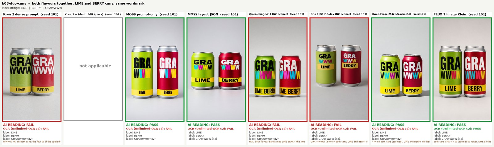

# image-model-text-test

Six open image models, one question: can they spell? We gave each of them the same ten label jobs (a hoodie, soda cans, end cards, a
poster, a name badge), three seeds each, and checked the lettering letter by letter. Then we ran nine prompts "beyond labels"
(portraits, hands, feet, a crowd, a landscape, a rainy street, a counting test, an illustration) and six "hard prompts" with a pass or fail rubric
(counting, colour binding, left and right, a sentence on a sign, a handshake, a clock that must read 3:45), and scored those too.

The models: **Krea 2** (Turbo), **MOSS-Image** (SFT), **Qwen-Image-2.1**, **FIBO 2.0-dev**, **Qwen-Image-2512** and **FLUX 3 Image Klein**. All of them ran locally on one
24 GB RTX 4090, through ComfyUI 0.42.1 (five of them) or Hugging Face diffusers (FIBO; FIBO also ran natively in a newer ComfyUI, for a speed comparison). This repository holds the prompts, the ComfyUI workflows,
the scripts, the raw results and reduced comparison grids. It holds no model weights.

- Video: TODO (link added when the video is public)



## The short version

All of this is "on our ten briefs, three seeds each, in this set-up". It describes these model variants as we ran them, not the models in general.

- **The pre-registered rule is met, by one retry, after we fixed a bug in our own scorer.** Before generating anything we wrote down a rule for "does MOSS-Image replace Krea 2 for readable labels".
  With the OCR reader that our own controls validated, MOSS matched or beat Krea 2 on 8 of 10 briefs (the rule needs 8) and needed 15 rerolls against Krea's 16 (the rule needs fewer). Our first scorer gave 14 against 14, "not met, by a tie";
  two days later we found that it let a letter from the next line complete a word, and the fix moved the verdict. The margin is one reroll: [the story and both sets of numbers are below and in `results/SCORER-FIX.md`](#a-bug-in-our-scorer-and-what-it-did-to-the-verdict).
- **The reader of record and the AI reading disagree a lot.** The reader of record agrees with an AI model's own reading of the pictures on 48 of 105 images. Read by that AI model, MOSS with
  a plain prompt got 28 of 30 labels exactly right, Krea 2 got 26 of 30 and **FLUX 3 Image Klein got 30 of 30**. We report both readings and do not pick the one we like.
- **Repeated letters are the hard part.** Our wordmark has four W. Qwen-Image-2.1 and Qwen-Image-2512 drew three w in all nine lowercase wordmark images
  (the AI reading and a glyph count agree); Krea 2, FIBO and Klein got all nine right, MOSS 8 of 9. On the uppercase and the poster jobs the order changes.
- **Beyond labels, human realism is close to a tie** on this reading: all six models score 3.9 to 4.25 on realism and anatomy for the four human prompts.
  A person's blind picks (one vote per prompt) went to Qwen-Image-2.1 5.5, Krea 2 2.5, FIBO 0.5, Qwen-Image-2512 0.5, MOSS-Image 0; in a second blind round with all six models on new sheets the voter kept the same nine picks and Klein received no vote.
- **On the six hard prompts** (12 images per model) Qwen-Image-2.1 passed 12, Krea 2, MOSS-Image and Klein 10, FIBO 7, Qwen-Image-2512 6. The clock was the discriminator: only Qwen-Image-2.1 got 3:45 on both seeds.
- **Speed and memory differ a lot:** 10.2 s per image for Klein, 12.6 s Krea 2 Turbo, 18.4 s Qwen-Image-2.1, 27.6 s MOSS-Image, 81.7 s FIBO (30 steps, diffusers), 112.7 s Qwen-Image-2512, on a 4090. FIBO natively in ComfyUI takes 27 s with its int8 file.
- Three seeds per cell and one or two seeds per portrait is a very small sample. The numbers are a log of what happened, not a benchmark.

## What we tested

### The label test

Ten briefs from our own productions, with fictional brands only (the "grawwww" wordmark, the GRAWWWW LIME and BERRY cans), no faces and no private LoRA.
Canvas 1024x1792, seeds 101, 102, 103 (the same seed numbers in every model are repeats, not pairings). Details and the exact prompts: `prompts/briefs.json`.

| id | brief | label strings checked |
|---|---|---|
| b01 | hoodie flat lay | `grawwww` (lowercase, four w) |
| b02 | hoodie chest crop, faceless | `grawwww` |
| b03 | LIME can, hero shot in a meadow | `GRAWWWW`, `LIME` |
| b04 | BERRY can, hero shot in a pastel valley | `GRAWWWW`, `BERRY` |
| b05 | 500 ml black can with neon slime | `GRAWWWW` |
| b06 | end card | `GRAWWWW` (twice), `LIME · BERRY`, footer line |
| b07 | hoodie end card | `grawwww`, subtitle, footer line |
| b08 | two cans side by side | `GRAWWWW` (twice), `LIME`, `BERRY` |
| b09 | headline poster | `650 S TO 72 S` and two more lines |
| b10 | name badge with an AI label | a fictional presenter name and `AI-GENERATED PRESENTER` |

### The arms (what each model was given)

| arm id | model, exactly as run | prompt | settings | licence (as tagged or stated by the publisher) |
|---|---|---|---|---|
| `krea-dense` | Krea 2 Turbo fp8, open weights, run locally (no LoRA) | the dense prompt | 9 steps, er_sde / beta, cfg 1 | Krea 2 Community License |
| `krea-ie` | the same + Krea 2 Identity Edit v1.2 (a Krea 2 derivative) | the pack shot of the product as reference, scene in text. Only b01 to b05 (the others have no pack shot) | 10 steps, euler, ref_boost 4 | Krea 2 Community License |
| `moss-prompt` | MOSS-Image SFT int8 (ComfyUI repack by Comfy-Org), Qwen3.5-9B int8 encoder, FLUX.2 small decoder | the same dense prompt, prompt upsampler off | the publisher's: 50 steps, cfg 3, euler, skip-layer 22 | Apache-2.0 |
| `moss-layout` | the same | a layout JSON (text and boxes), written once by hand per brief | the same | Apache-2.0 |
| `qwen21` | Qwen-Image-2.1 int8 (repack by Comfy-Org), Qwen3-VL-8B int8 encoder | the same dense prompt, prompt enhancer off | 40 steps, euler, cfg 1 (model card) | Qwen Research License: **non-commercial** |
| `fibo` | FIBO 2.0-dev bf16, local diffusers pipeline, never the Bria API | its native structured JSON caption, written once by hand per brief (`prompts/fibo_captions.json`) | guidance 5.0, **30 steps** (the card says 50: the first image at 50 steps took 136 s, which fired a time rule we wrote before the run) | CC BY-NC 4.0 per its model card: **non-commercial** |
| `qwena` | Qwen-Image-2512 fp8 (repack by Comfy-Org), Qwen2.5-VL-7B fp8 encoder | the same dense prompt | 50 steps, euler, cfg 4, shift 3.1, the template's negative prompt | tagged Apache-2.0 on its model card |
| `klein` | FLUX 3 Image Klein, the distilled checkpoint, bf16 transformer from Black Forest Labs' own repository, Qwen3-VL-4B-Instruct encoder, FLUX.2 VAE | the same dense prompt, **prompt upsampler off** (the card asks for one; our prompts are already full scene captions) | 16 steps, euler, cfg 1 (the card's defaults) | FLUX Kommunity License v.1.0 |

225 images in total (30 for each arm except `krea-ie`, which has 15; see `results/`). The workflows are in `workflows/comfyui/`
(ComfyUI API format, brief b03, seed 101); FIBO has no ComfyUI graph in the 0.42.1 runs, `workflows/screenshots/workflow_fibo_diagram.png` is a diagram of its pipeline and
`scripts/fibo_labels.py` is the pipeline itself. Screenshots of the other graphs, as loaded in the ComfyUI interface, are next to it.

### The "beyond labels" set

Nine prompts, one intent each: a presenter portrait (waist up, a raised hand), two hands holding the can, an elderly man in window light, four friends at a café table,
a hiker on a ridge at golden hour, a rainy night street with a cyclist, a counting test (three red cubes stacked on the left, two blue spheres on the right, a green pyramid
in the middle), an anime bookshop illustration, and a casual lifestyle photo with bare feet. Fictional people only, no real likeness. Same models and settings as above.
Seeds 101 and 102 for every model, except Qwen-Image-2512 on p1 to p8, where only seed 101 was run (its second seed costs about 16 more GPU minutes).
100 images. **The prompt formats differ by model on purpose and the intent is the same:** five models got the same dense prompt, FIBO its structured JSON caption. All in `prompts/battery2.json` and `prompts/battery2_p9.json`.

### The hard prompts

Six prompts in the style of the usual compositional benchmarks, each with a short list of objective pass or fail items written **before any image existed** (`prompts/battery3.json`): exactly seven red apples in one row; two stacks with swapped colours (a blue cube on a red sphere, a red cube on a blue sphere);
a cat left of a dog with a yellow scarf on the dog only; a café chalkboard that reads `FRESH BREAD DAILY 7AM-2PM`; a handshake with exactly two hands, five fingers each; a person holding a clock that shows 3:45. Two seeds per model, same arms and settings, 72 images. An image passes only if every item passes.

### FIBO natively in ComfyUI

FIBO 2.0 Dev got native ComfyUI support after 0.42.1. On a test copy of ComfyUI 0.42.1 with the files of that commit added, we ran the same structured captions through the native nodes, once with the Comfy-Org repack's int8 file and once with its bf16 file (two images each: one label brief and one beyond-labels prompt, 30 steps, guidance 5.0), to compare speed and memory with our diffusers run. Graph: `workflows/comfyui/workflow_fibo_comfyui_api.json`, screenshot in `workflows/screenshots/`. We did not score these four images with the rubrics: they are an existence proof and a stopwatch, not a comparison.

## How we measured

An image passes a label brief when every expected string shows up in a reader's text (letters and digits only, case and punctuation ignored, so `GRAWWWWW` does not pass for `GRAWWWW`; the rule is `scripts/scoring.py`). We used two kinds of reader. Before any test image existed, we ran an OCR model, Unlimited-OCR (Baidu, MIT), in three configurations on 38 control images (rendered strings with and without a one-letter error, real pack shots, generated photos and posters judged by the AI reading below) and wrote down in `results/PREREG.md` (with three addenda: one written before the first test image, one after scoring that only fixed wording, one for the scorer bug fix of 2026-10-22) that the configuration with the best balanced accuracy would be the reader of record, and that a reader is valid only if it passes at least 80 % of the right strings and rejects at least 90 % of the wrong ones. Configuration c2 (overlapping horizontal bands) won and was valid by exactly the threshold (20 of 25 right strings, 12 of 13 wrong ones rejected); the other readers were not valid. The second kind of reader is an AI vision model (Claude, by Anthropic) that looked at every image, zoomed in on the lettering, counted letters (for the lowercase wordmark it also counted connected glyph components on enlarged crops) and wrote pass or fail with a note; no person graded the label images. The pre-registered rule for "MOSS-Image joins as a still generator" was: the better MOSS arm per brief at least matches Krea 2 with the dense prompt on 8 of 10 briefs, and needs fewer rerolls in total (a reroll is a failed seed before the first pass, in the order 101, 102, 103; no pass in three seeds counts 3). With the reader of record and the fixed scorer the rule reads **met, by one reroll**; our first scorer said "not met, by a tie", and both are reported below. The beyond-labels prompts have no OCR: the same AI model scored realism, anatomy, composition and a subjective "looks less generic" score from 1 to 5 on shuffled, lettered sheets without knowing which model drew which image, and one person did a separate blind ranking on lettered sheets. The hard prompts were read by the AI model against the written items on blind lettered sheets, with enlarged crops for hands and clocks; the chalkboard sentence was also checked by the OCR reader of record.

## A bug in our scorer, and what it did to the verdict

On 2026-10-22, two days after the first results and before this repository or the video went out, our own verification pass found a bug in our scoring script (kept as `scripts/scoring_pre_fix.py`). To let a stacked wordmark such as `GRA` over `WWWW` count as `GRAWWWW`, the scorer let a match continue on the next OCR line, but it allowed that at any position of the target, so a letter from an unrelated next line could complete it. On the b07 hoodie card the reader returned `grawww` (three w) followed by the line `washed black hoodie`, and the scorer counted the w of "washed" as the fourth w of `grawwww`: a pass that belonged to our scorer, not to the reader. We fixed it (a match may cross a line break only when the break splits the target itself and the continuation is a whole word; `scripts/scoring.py`, 31 unit tests in `scripts/test_scoring.py`), re-scored every stored OCR output (1,177 items: only the lowercase wordmark of b07 changes; 36 image-level results across all readers go from pass to fail and none the other way) and left everything else alone: the controls score identically, the reader of record is the same configuration and still valid, the AI readings and the other batteries are unchanged. The verdict of record moved, by the rule exactly as written: **8 of 10 briefs (unchanged), rerolls MOSS 15 against Krea 16 (before: 14 against 14), fewer, so the rule is met (before: not met, by a tie).** Please read it as thin: it rests on one reroll on one brief (b07) with three seeds per cell, the reader that decides it undercounts the repeated letters it is judging (on b07 it returns `grawww` for cards the AI reading counts as four w), and each MOSS arm alone still fails under it (MOSS prompt 7 of 10 briefs, rerolls 20 against 16; MOSS layout 7 of 10, 18 against 16). We did not move the rule or the thresholds. The old and new numbers for every reader, arm and changed image are in [`results/SCORER-FIX.md`](results/SCORER-FIX.md); `scripts/rescore.py` recomputes the new ones.

## Results

### Label test, by arm

Images passing out of 30 (`krea-ie`: out of 15) and total rerolls over the briefs where the arm ran. A brief with no pass in three seeds counts 3 rerolls. The reader of record column uses the fixed scorer.

| arm | reader of record: images passing, rerolls | AI reading: images passing, rerolls |
|---|---|---|
| `krea-dense` | 10/30, 16 | 26/30, 3 |
| `krea-ie` (b01 to b05) | 3/15, 12 | 9/15, 6 |
| `moss-prompt` | 7/30, 20 | 28/30, 1 |
| `moss-layout` | 8/30, 18 | 22/30, 5 |
| `qwen21` | 7/30, 20 | 20/30, 10 |
| `fibo` | 12/30, 16 | 20/30, 9 |
| `qwena` | 5/30, 22 | 19/30, 9 |
| `klein` | 10/30, 17 | 30/30, 0 |

Per brief, for both readers, with every miss: `results/results_extra_tables.md` (Krea 2 dense, both MOSS arms and the four later arms side by side) and `results/results_tables.md` (the first four arms, plus every reader and the controls).

### The pre-registered rule, by reader

Best MOSS arm per brief against `krea-dense`. The rule is met only if both columns are met: at least as good on 8 of 10 briefs, and fewer total rerolls.

| reader | valid on the controls | briefs MOSS >= Krea 2 | rerolls MOSS / Krea 2 | rule |
|---|---|---|---|---|
| **Unlimited-OCR c2 (reader of record)** | **yes** | **8 / 10** | **15 / 16** | **met, by one reroll** |
| Unlimited-OCR c0 (whole image) | no | 10 / 10 | 10 / 19 | met |
| Unlimited-OCR c1 (whole image, base config) | no | 8 / 10 | 17 / 18 | met |
| RapidOCR | no | 9 / 10 | 5 / 14 | met |
| local vision-language model transcribing | no | 9 / 10 | 2 / 4 | met |
| AI reading (not validated on controls) | n/a | 9 / 10 | 1 / 3 | met |

Before the scorer fix the reader of record read 14 / 14, "not met", and the other readers read 10 / 18, 16 / 18 (9 of 10 briefs), 5 / 14, 1 / 4 and 1 / 3: the fix changed one verdict and left the other five as they were.

How far to trust this: the reader of record passes 28 of the 85 images the AI reading called correct and rejects 20 of the 20 it called wrong (48 of 105 agree); on Qwen-Image-2.1, FIBO and Qwen-Image-2512 it agrees on 51 of 90 images, on Klein on 10 of 30 (it passes only 10 of the 30 Klein images that the AI reading calls all correct). It was validated on controls that held few big display-type images, and it undercounts repeated letters. The AI reading is one reader, subjective, and had to resolve a few disputed counts by hand (e.g. the lowercase wordmark on the hoodie); its verdict (rule met) does not change when the disputed readings are resolved against MOSS (8 of 10 briefs, rerolls 1 against 3). Three seeds per cell.

### Where the letters go wrong (AI reading, images passing)

| arm | lowercase wordmark `grawwww` (b01, b02, b07), 9 images | the other seven briefs (b03 to b06, b08 to b10), 21 images |
|---|---|---|
| `krea-dense` | 9 / 9 | 17 / 21 |
| `moss-prompt` | 8 / 9 | 20 / 21 |
| `moss-layout` | 2 / 9 | 20 / 21 |
| `qwen21` | 0 / 9 (always three w) | 20 / 21 |
| `fibo` | 9 / 9 | 11 / 21 (three W on the cans in several images) |
| `qwena` | 0 / 9 (always three w) | 19 / 21 |
| `klein` | 9 / 9 | 21 / 21 |

(`krea-ie`: 6 / 6 on the lowercase wordmark, 3 / 9 on the cans, where the pack shots themselves clip the W row and the copy reproduces the clipping.)

### Beyond labels

Mean of the AI reading, 1 to 5 (5 best), prompts p1 to p8, two seeds (Qwen-Image-2512: one). "Looks less generic" is a subjective score (5 = no stock "AI look"); it is our opinion, not a fact about a model.

| model | images | realism | anatomy | composition | looks less generic | overall | human prompts p1-p4, realism + anatomy |
|---|---|---|---|---|---|---|---|
| Krea 2 Turbo | 16 | 4.19 | 4.19 | 4.38 | 3.81 | 4.14 | 4.19 |
| FIBO 2.0-dev | 16 | 4.25 | 4.06 | 3.75 | 4.06 | 4.03 | 4.25 |
| Qwen-Image-2.1 | 16 | 4.00 | 3.94 | 3.75 | 3.69 | 3.84 | 4.06 |
| MOSS-Image | 16 | 4.00 | 3.94 | 4.00 | 3.31 | 3.81 | 4.00 |
| Qwen-Image-2512 | 8 | 3.88 | 4.00 | 4.12 | 3.25 | 3.81 | 4.25 |
| FLUX 3 Image Klein | 16 | 4.00 | 4.00 | 3.75 | 3.44 | 3.80 | 3.94 |

The extra prompt p9 (feet, two seeds, overall): Qwen-Image-2.1 4.25, Krea 2 Turbo 4.12, FIBO 4.00, Qwen-Image-2512 3.88, MOSS-Image 3.75, Klein 3.75. Per prompt, with notes for every image: `results/results_battery2_tables.md`,
`results/results_battery2.json`, and the grids in `grids/beyond-labels/`. Krea 2 here is the base model without any LoRA: nothing in this set says whether another model would keep a character's identity.
The counting prompt (p7, five facts): Krea 2 5 / 5 on both seeds, MOSS-Image 5 / 5, FIBO 5 and 4, Qwen-Image-2.1 4 and 4, Klein 3 and 5, Qwen-Image-2512 4.
Klein's pages were read with one Krea 2 image on each page as an anchor, with private letters; the anchor's new ratings differed from its earlier ratings by 0.31 on average (absolute difference over 36 ratings), so the scale held.

**Blind picks.** One person (the host of the channel, not an AI model) picked a favourite per prompt on lettered contact sheets of seed 101, with the letters shuffled for each prompt and the key opened afterwards. A two-letter answer counts half each.
Tally over the nine prompts: Qwen-Image-2.1 5.5, Krea 2 Turbo 2.5, FIBO 2.0-dev 0.5, Qwen-Image-2512 0.5, MOSS-Image 0. The picks and the rule are in `results/blind_vote.json`.
**Second round, six models.** Klein was not on the first sheets, so we ran the vote again on nine new sheets (one per prompt, seed 101) with all six models and the letters shuffled again. The voter looked at them and kept the same nine picks; FLUX 3 Image Klein received no vote. Six-model tally: Qwen-Image-2.1 5.5, Krea 2 Turbo 2.5, FIBO 2.0-dev 0.5, Qwen-Image-2512 0.5, MOSS-Image 0, Klein 0. One voter, one seed, and the second round was not independent of the first: a taste test, nothing more.

### The hard prompts

Images passing out of 2 seeds per prompt (AI reading against the written items; the rubric is in `prompts/battery3.json`, one line per failed image in `results/results_battery3_tables.md`, grids with PASS or FAIL under each image in `grids/hard-prompts/`).

| model | total, of 12 | h1 seven apples | h2 colour binding | h3 cat, dog, scarf | h4 chalkboard sentence | h5 handshake | h6 clock 3:45 |
|---|---|---|---|---|---|---|---|
| Qwen-Image-2.1 | **12** | 2 | 2 | 2 | 2 | 2 | 2 |
| Krea 2 Turbo | 10 | 2 | 2 | 2 | 2 | 2 | 0 |
| MOSS-Image | 10 | 2 | 2 | 2 | 2 | 2 | 0 |
| FLUX 3 Image Klein | 10 | 2 | 2 | 2 | 2 | 2 | 0 |
| FIBO 2.0-dev | 7 | 0 | 2 | 2 | 2 | 0 | 1 |
| Qwen-Image-2512 | 6 | 0 | 2 | 2 | 0 | 2 | 0 |

What failed: FIBO drew 8 apples twice and Qwen-Image-2512 drew 6 twice; FIBO's handshake images pulled back and showed extra hands; Qwen-Image-2512 added a trailing full stop after `7AM-2PM` on both chalkboards (a strict-rule fail); and on the clock, Krea 2, MOSS-Image, Klein and Qwen-Image-2512 got the hands wrong on both seeds, FIBO on one. Colour binding, left and right and the negation (only the dog wears the scarf) were solved by all six models on both seeds. The chalkboard sentence was also checked by the OCR reader of record: it passes Qwen-Image-2.1, Klein and Qwen-Image-2512 on both seeds, FIBO on one, Krea 2 and MOSS-Image on none, while the AI reading passes all twelve images except Qwen-Image-2512's two (the trailing full stop). Two seeds per cell: very small samples, and an objective rubric still read by one AI model.

### Speed and memory (RTX 4090, 24 GB)

Seconds per image are the warm median (the first image after switching model, which includes loading, is slower). VRAM is the whole card as `nvidia-smi` saw it, in GiB (1 GiB = 1024 MiB), and it includes
about 2.0 GiB that other idle processes were holding; they are the maximum of the runs that loaded everything, not tuned minimums. Files = the model files of the arm on disk.

| model | s/img, labels | s/img, beyond labels | s/img, hard prompts | peak GiB, labels | peak GiB, beyond labels | peak GiB, hard prompts | files, GiB |
|---|---|---|---|---|---|---|---|
| FLUX 3 Image Klein (bf16) | 10.2 | 10.7 | 10.6 | 23.5 | 23.5 | 23.5 | 18.9 |
| Krea 2 Turbo (`krea-dense`) | 12.6 | 12.8 | 12.7 | 20.9 | 21.2 | 20.9 | 17.4 |
| Qwen-Image-2.1 | 18.4 | 18.7 | 18.6 | 18.7 | 18.7 | 18.7 | 16.1 |
| Krea 2 + Identity Edit (`krea-ie`) | 28.7 | n/a | n/a | 23.2 | n/a | n/a | 19.1 |
| MOSS-Image (`moss-prompt`, `moss-layout`) | 27.6, 28.1 | 28.0 | 27.9 | 18.2 | 18.6 | 18.6 | 14.4 |
| FIBO 2.0-dev, 30 steps (diffusers) | 81.7 | 81.7 | 81.7 | 22.5 | 23.3 | 22.5 | 23.7 |
| Qwen-Image-2512 | 112.7 | 118.9 | 119.7 | 23.3 | 23.2 | 23.3 | 28.0 |

FIBO at its card's 50 steps would take about 136 s per image (one image measured). Its encoder (8.9 GB) and transformer (16.3 GB) do not fit together on 24 GB, so `fibo_labels.py` encodes every caption first, frees the encoder, then loads the transformer;
the maths is the stock pipeline's. Qwen-Image-2512 (20B) runs on 24 GB only because ComfyUI streams part of its weights, and Klein bf16 reaches 23.5 GiB of the card because ComfyUI streams its weights too: nothing else may share the card with either. We tried nothing smaller than a 24 GB card: no claim for other cards. The whole test took about 5.5 hours of GPU time.

**FIBO 2.0 Dev, native ComfyUI against diffusers** (same captions, 30 steps, guidance 5.0; the first image of each run includes loading the model; peak = whole card):

| run | b07 hoodie card, s | b07 peak GiB | p6 rainy night, s | p6 peak GiB |
|---|---|---|---|---|
| ComfyUI native, int8 ConvRot file (Comfy-Org repack) | 36.4 (cold) | 19.1 | **27.2** (warm) | 15.3 |
| ComfyUI native, bf16 file (Comfy-Org repack) | 77.6 (cold) | 22.9 | 69.5 (warm) | 23.5 |
| diffusers bf16 (our run, `fibo_labels.py`) | 81.7 | 22.5 | 81.6 | 22.5 |

Native bf16 is about 15 % faster than diffusers; native int8 is about 3 times faster with a lower peak, and the repack's card says its int8 outputs differ slightly from the original. The images are not pixel-identical (ComfyUI draws its own initial noise) but show the same content: all three hoodie cards read `grawwww`, `washed black hoodie` and the AI line, and the rainy-street scene is the same kind of scene (`grids/fibo-native-vs-diffusers/`: diffusers, native int8, native bf16). Two images per run, one seed: a stopwatch, not a quality comparison.

## What we did not test

- Other hardware, other resolutions (Qwen-Image-2.1's native size is 2K; we kept 1024x1792 for every arm), other step counts (FIBO at 50 steps beyond one image).
- Prompt enhancers and upsamplers (MOSS-Image's, Qwen's; Klein's card asks for one and we left it off in every scored run; one informational run with it on the hard prompts was not scored and is not published), other layouts, other prompts for the same brief: each arm got one prompt per brief, written once and not tuned per result.
- Klein's int8 files (they sit in a separate gated repository of the publisher), Klein Base, any editing or multi-image feature of any model; FIBO's Edit Turbo and turbo LoRA; native FIBO on the rubrics (four images only).
- Z-Image-Turbo, which was the other permissive-licence candidate for the open slot, and any model not named here. The hosted products of Krea, Bria and Black Forest Labs, and Bria's cloud API: we ran open weights locally only.
- The local vision-language reader on the extra arms; a person reading the label images or the hard prompts (a person only did the blind picks on the beyond-labels set); identity consistency for a character (no LoRA in any arm).
- Qwen-Image-2512's second seed on p1 to p8. Training-data provenance and the legal status of outputs, for any model.
- Any claim about the models in general: three seeds per label cell, one or two seeds per portrait and two per hard prompt is a very small sample.

## What is in the repo

| path | what |
|---|---|
| `prompts/briefs.json` | the ten briefs: dense prompt, layout JSON, Identity Edit prompt, label strings and the minimum count of each (the published copy has its `source` and `ie.ref` fields reworded; everything the models and the scorer see is unchanged) |
| `prompts/battery2.json`, `battery2_p9.json`, `battery3.json` | the beyond-labels prompts, the hard prompts with their rubric (written before generation) and the FIBO captions, with the settings per model |
| `prompts/fibo_captions.json` | FIBO's JSON captions for the ten briefs (`scripts/fibo_captions.py` regenerates it byte for byte) |
| `prompts/controls.json`, `controls_real.json` | the 38 reader controls: the expected strings and whether each should pass |
| `workflows/comfyui/` | the ComfyUI API-format graph of each of the seven ComfyUI arms (brief b03, seed 101) and of FIBO natively (b07, seed 101); `workflows/screenshots/` the graphs as loaded in the interface, and the FIBO diagram |
| `scripts/` | generation, readers, scoring, tests, grids (below) |
| `results/` | `results.json` (the four first arms, every reader, every image), `results_extra.json` (Qwen-Image-2.1, FIBO, Qwen-Image-2512, Klein), `results_battery2.json`, `results_battery3.json`, the tables, `blind_vote.json`, `battery3_reading.json` (the AI reading of the hard prompts), `PREREG.md` (the rule, with its three addenda), `SCORER-FIX.md` (the bug, old and new numbers) and `logs/` (one line per image: seconds, whole-card VRAM) |
| `grids/labels/` | per brief, seed 101 and all three seeds, every arm side by side; under each image the AI reading, the reader of record and the expected strings (green frame: the AI reading passed it, red: failed; `krea-ie` is "not applicable" for b06 to b10) |
| `grids/beyond-labels/` | per prompt, seeds in rows, models in columns, with the AI reading's four scores |
| `grids/hard-prompts/` | per hard prompt, two seeds, six models, PASS or FAIL under each image and a note on every failure |
| `grids/fibo-native-vs-diffusers/` | FIBO: diffusers, native int8, native bf16, for two prompts |

Grids are JPEG, at most 1600 px wide, so each image is small. There are no full-size images and no weights. In the JSON, the scripts and the tables, `agent_read` ("agent visual reading" in `PREREG.md`) is the AI reading, `unl_c0/c1/c2` are the three Unlimited-OCR configurations, `rapid` is RapidOCR and `vlm` the vision-language reader.
`t004` in some names is our own number for this test. The one extra prompt we generated and did not use (a revised presenter prompt) is left out of the logs and the tables.

| script | what |
|---|---|
| `scoring.py` | the match rule, fixed 2026-10-22 (sha256 `1e53cb5b3fb7cfc87dbd1699ec414855280e225baff3605497110f45260c2ce4`, byte-identical to the scorer that produced the numbers; its docstring names copies from our working folder: the earlier versions are `scoring_pre_fix.py` and `scoring_v1.py`). Standard library |
| `scoring_pre_fix.py`, `scoring_v1.py` | the two earlier scorers, byte-identical copies kept for the record and for the tests: the line-aware one with the bug (sha256 `f40391edfdda3c512337f58e37f38f1b0e269602c3f91785e210cd7cc91dfc26`), and the first joined one pinned in `PREREG.md` (`7c200ff635aae233c3774f8d73b90111d3b7699abdde9de496ed01cf8aa66854`) |
| `test_scoring.py` | 31 unit tests of the scorer: the b07 case fails, `LARA` / `AI-GENERATED PRESENTER` still passes, stacked wordmarks and a four-line sign pass. Run from the repository folder: `python3 -m unittest -v scripts/test_scoring.py` |
| `rescore.py` | **no GPU, no images:** recomputes every pass or fail from the stored reader texts, the totals, the pre-registered verdicts, the beyond-labels means, the hard-prompt passes, the blind tally and the seconds per image from the logs, and checks them against the stored numbers |
| `gen_comfy.py` | builds each arm's graph and queues it on a running ComfyUI (`dump`, `labels`, `battery2`, `battery3`, `free`). Standard library |
| `fibo_labels.py`, `fibo_battery2.py`, `fibo_battery3.py`, `fibo_captions.py`, `fibo_diagram.py` | the FIBO arm (diffusers) and its captions |
| `fibo_comfy_run.py` | FIBO in native ComfyUI (needs a ComfyUI build that has the native nodes) |
| `merge_safetensors_shards.py` | merges Klein's two text-encoder shards into the single file ComfyUI's loader wants (tensors and bytes unchanged) |
| `ocr_run.py`, `rapid_ocr.py`, `vlm_reader.py` | the readers: Unlimited-OCR (c0, c1, c2), RapidOCR, an optional vision-language model through any OpenAI-compatible endpoint |
| `make_controls.py`, `gate_eval.py` | render the 24 synthetic controls; sensitivity, specificity and validity of a reader on the controls |
| `final_score.py`, `score_extra.py`, `battery2_score.py`, `battery3_score.py` | the scripts that wrote `results/`; they read your own raw reader output (file names below) |
| `make_label_grids.py`, `battery2_sheets.py`, `battery3_sheets.py`, `reduce_grids.py` | the grids, the shuffled sheets for blind reading and voting, the reduction to JPEG |

Not included: the glyph-counting helpers we used on enlarged crops of the lowercase wordmark, the scan and comparison scripts of the scorer fix, the download and set-up shell scripts of our machine (the steps are below), the montage script of the FIBO comparison, and the images.

## Reproduce

Check the numbers first, no GPU needed: `python3 scripts/rescore.py` (it prints the tables above and ends with `OK`) and `python3 -m unittest scripts/test_scoring.py`.

**To generate and score your own run** you need a 24 GB NVIDIA card, ComfyUI **0.42.1** (MOSS-Image is a core model from 0.42.0; Python 3.12.3, torch 2.13.0+cu130 in our container), and for the Krea Identity Edit arm the node pack
`lbouaraba/comfyui-krea2edit` at commit `86f886d`. Put the files here (sizes in bytes; sha256 where we recorded it, all the Comfy-Org ones equal Hugging Face's LFS hash). Read each licence before downloading: four of these models are gated or limited (Krea 2, Qwen-Image-2.1, FIBO 2.0-dev, Klein).

| folder in `ComfyUI/models/` | file | bytes | sha256 | source |
|---|---|---|---|---|
| `diffusion_models/` | `krea2_turbo_fp8_scaled.safetensors` | 13141730784 | `eb4dd8c612cfd10f64f25b057e6e6bbcb5737c94a7372177e456dbf7579502f1` | Krea 2 Turbo, huggingface.co/krea/Krea-2-Turbo (gated); we did not record which repository this fp8 file came from |
| `text_encoders/` | `qwen3vl_4b_fp8_scaled.safetensors` | 5242467968 | `54bd5144df0bbc25dd6ccadfcb826b521445a1b06ae5a42570bdd2974ca87094` | the Krea 2 encoder |
| `vae/` | `qwen_image_vae.safetensors` | 253806246 | `a70580f0213e67967ee9c95f05bb400e8fb08307e017a924bf3441223e023d1f` | huggingface.co/Comfy-Org/Qwen-Image_ComfyUI |
| `loras/Krea2/` | `krea2_identity_edit_v1_2.safetensors` | 1828256432 | `6adf9a69cc9502d286db7b69964d37da7e9cfe4b05b4d004bc275f087d3fd3cf` | huggingface.co/conradlocke/krea2-identity-edit (commit `89e9e7a`) |
| `diffusion_models/` | `moss_image_sft_int8_convrot.safetensors` | 5413698958 | `b4d1475bc7eeffd7b809e82ea13a1fba1fb85c4e18365af3813722faa5c0fe4f` | huggingface.co/Comfy-Org/MOSS-Image, revision `3284a1dbb351e3396d70f39f2a71cbf6ed2ef1bb` |
| `text_encoders/` | `qwen3.5_9b_int8_convrot.safetensors` | 9748121532 | `32e3787472f708fa5f83624acbf5ef23f7fc89c439e05065ea57cfe5a97f025a` | same |
| `vae/` | `flux2-vae_small.safetensors` | 249521340 | `d8d52ba036475f5fb07c8b435e176d3d97ebfa82f0d1a1c317f9cc1e25bd013b` | same |
| `diffusion_models/` | `qwen_image_2.1_int8_convrot.safetensors` | 7256783064 | `cb74113cb03faecd79611b01fd7fd642f0aa60d6f0b95086abee214d75eaa57d` | huggingface.co/Comfy-Org/Qwen-Image-2.1 |
| `text_encoders/` | `qwen3vl_8b_int8_convrot.safetensors` | 9350798360 | `8bfd0f6e12abf2d2d697ecc888e5e90b0d6741d6708f05799f53afa560452e8f` | same |
| `vae/` | `qwen_image_2.1_vae_bf16.safetensors` | 675509688 | `bb21f7473051e1ac368515dd3f2e15cd44d7a11748ee8823e1ddca3e4876b7c9` | same |
| `diffusion_models/` | `qwen_image_2512_fp8_e4m3fn.safetensors` | 20430679144 | `5dc80554d5d83390046a2f4a94ece06afb7700bf7b0aaf8bde9769793875876b` | huggingface.co/Comfy-Org/Qwen-Image_ComfyUI, revision `1f12b17be14c89b026c51a91d67c32f84bb047bc` |
| `text_encoders/` | `qwen_2.5_vl_7b_fp8_scaled.safetensors` | 9384670680 | `cb5636d852a0ea6a9075ab1bef496c0db7aef13c02350571e388aea959c5c0b4` | same |
| `diffusion_models/` | `flux3-image-klein-bf16.safetensors` (the repository's `model.safetensors`, renamed) | 11097404512 | `c3e9813cdd049c831c836b2e9db61150e49a93fc1a4c63b256494642fee0bd7c` | huggingface.co/black-forest-labs/flux-3-image-klein, revision `337337621b8526e120f2275d250242f4a6bedd75` (gated) |
| `text_encoders/` | `qwen3vl_4b_instruct_bf16_bfl-merged.safetensors`: the repository's two shards `text_encoder/model-00001-of-00002.safetensors` (4967229296 B, `30a01a0556622645a3cce87b655bbbbbc1f170c196099f1b666c93202c3339a9`) and `-00002-of-00002` (3908490048 B, `046296a2a387efb43b0c997d5833c789604d168834f6e0d3064bf7bb13d002a6`), merged with `scripts/merge_safetensors_shards.py` | 8875719408 | `1e907c4ed87e76400e2351705b707a801095e6befb92c0e74f9f150e00f6fd4b` (our merge) | same |
| `vae/` | `flux2-vae.safetensors` (the repository's `ae.safetensors`, renamed) | 336211292 | `868fe7b343cc8f3a19dbcfcafbc3d5f888802be3f89bd81b65b3621a066ce8f3` | same |

Klein's publisher also has a separate gated repository with ComfyUI files (int8 among them); we did not use it. For **FIBO natively in ComfyUI** you need a ComfyUI build that contains pull request #17240 (merged 2026-10-21, commit `87ed5a066d9c4660ef42100fd01a888da6994856`), which is newer than 0.42.1 (we ran 0.42.1 on a test copy with the 13 files of that commit added), and the Dev files of `huggingface.co/Comfy-Org/Fibo-2.0` at revision `b2bffaf57d48825a6989b986f24d5cfb8c71231b`: `diffusion_models/fibo2_dev_int8_convrot.safetensors` (8408562474 B, `063dd397395809fd22234c6bd32932cfcb22619f4d2282bdbf1dc58c406fe325`), `diffusion_models/fibo2_dev_bf16.safetensors` (16452934194 B, `2a09866ff073cae9114f5fd93c0f530f84d41f74dc06e3d0c1372587bb3e9984`), `text_encoders/qwen3vl_4b_int8_convrot.safetensors` (4858559240 B, `32de113cbf8282b02cbff0794b637b9d6676da09314a1db5a30bcea9bf4ee01c`), `text_encoders/qwen3vl_4b_bf16.safetensors` (8875719384 B, `36f3ff447ef59201722e8f9ce6020c9819fdcfba6aa2608c4e09b1c0ce114e34`) and the same `vae/flux2-vae.safetensors`. We used the Dev files only.

```bash
export COMFY_URL=http://localhost:8188          # your ComfyUI 0.42.1
export T004_WORK=$PWD/runs                      # images, raw reader output and logs go here (default: ./runs)
python3 scripts/gen_comfy.py dump ./graphs   # optional: writes the seven graphs; they equal workflows/comfyui/ byte for byte
python3 scripts/gen_comfy.py labels krea-dense moss-prompt moss-layout qwen21 qwena klein
python3 scripts/gen_comfy.py labels krea-ie --packs /path/to/packs      # optional: needs your own reference image per product, named as in prompts/briefs.json (ie.ref)
python3 scripts/gen_comfy.py battery2 101,102 krea-dense moss-prompt qwen21 qwena klein      # BATTERY_SPEC=prompts/battery2_p9.json for p9
python3 scripts/gen_comfy.py battery3 101,102 krea-dense moss-prompt qwen21 qwena klein
python3 scripts/fibo_comfy_run.py run          # FIBO natively, if your ComfyUI has the nodes
```

**FIBO** (diffusers; the weights are gated and non-commercial: accept and read Bria's terms yourself). `huggingface-cli download briaai/Fibo-2.0-dev --revision 530604492bf2bd1364ae43ca6b2bf2285ef0f2ba --local-dir fibo-2.0-dev` (the demo images and fine-tuning folder are not needed), then
`pip install -r requirements-fibo.txt` and `FIBO_DIR=$PWD/fibo-2.0-dev python3 scripts/fibo_labels.py` (`FIBO_STEPS=30` to skip the 130 s rule), `python3 scripts/fibo_battery2.py 101 102` and `python3 scripts/fibo_battery3.py 101 102`.

**Readers.** Unlimited-OCR from huggingface.co/baidu/Unlimited-OCR at revision `8249d20b2822a7d8a4c22c8d8c9069b5ac36bda3` (weights sha256 `2bc48a7a110061ea58fff65d3169367eebe3aee371ca6968dc2219c1b2855fc6`).
It runs the model's own Python files (`trust_remote_code`): read them first. We did and they make no network call; `eval_mode=True` skips the one code path that `eval()`s model output.
`pip install -r requirements-ocr.txt` (Python 3.12) and, for RapidOCR, `pip install rapidocr_onnxruntime==1.2.3`.

```bash
mkdir -p runs/ocr
python3 scripts/ocr_run.py --model /path/to/Unlimited-OCR --dir runs/images --glob '*.png' --config c2 --out runs/ocr/test_unl_c2.json      # also c0, c1
python3 scripts/rapid_ocr.py runs/images runs/ocr/rapid_test.json
```

`final_score.py` is the exact script that wrote `results/results.json`. It expects in `T004_WORK`: `ocr/test_unl_c0.json`, `test_unl_c1.json`, `test_unl_c2.json`, `rapid_test.json`, `test_vlm.json` (from `vlm_reader.py`),
`agent_reading.json` (`{"<image>.png": {"pass": true, "note": ""}}`: your own reading, by whoever or whatever you trust), `results_gen.jsonl`, and the same names for the controls if you want the validity table.
`score_extra.py` expects `ocr/extra_<arm>_unl_c0|c1|c2.json`, `ocr/extra_<arm>_rapid.json`, `ocr/agent_reading_extra.json` and the images of each extra arm in `images/<arm>/`.
`battery3_score.py` expects `ocr/battery3_reading.json` (the format of `results/battery3_reading.json`: one P or F per rubric item, and a note), `ocr/b3_h4_<arm>_unl_c2.json` and `results_battery3.jsonl`.
Set `T004_OUT` to write somewhere other than `results/`. On our own raw files, `final_score.py`, `score_extra.py`, `battery2_score.py`, `battery3_score.py`, `make_controls.py` and `fibo_captions.py` reproduce the published files byte for byte (apart from the pointer and heading lines we reworded for publication), and `gen_comfy.py dump` and `fibo_comfy_run.py workflows` reproduce the workflow files.
Grids: `python3 scripts/make_label_grids.py --out runs/grids` (needs Pillow and DejaVu Sans), then `python3 scripts/reduce_grids.py runs/grids out`.

## Credits and licences

Models, parts and licences (all run locally; no weights are redistributed; each part keeps its publisher's own licence)

Krea 2 Turbo fp8 (Krea): Krea 2 is licensed under the Krea 2 Community License Agreement. For more information, visit https://krea.ai/krea-2-licensing. Text encoder Qwen3-VL-4B fp8 (Alibaba Cloud, Apache-2.0); VAE: Qwen-Image VAE (Alibaba Cloud, Apache-2.0); Krea 2 Identity Edit v1.2 (conradlocke), a Krea 2 Derivative, for the pack-shot arm.

MOSS-Image-SFT int8 (OpenMOSS / MOSI.AI, Apache-2.0), ComfyUI repack by Comfy-Org. Text encoder Qwen3.5-9B int8 (Alibaba Cloud, Apache-2.0); VAE: FLUX.2 small decoder (Black Forest Labs, Apache-2.0).

Qwen-Image-2512 fp8 (Qwen / Alibaba Cloud), tagged Apache-2.0 on its Hugging Face model card (https://huggingface.co/Qwen/Qwen-Image-2512); ComfyUI repack by Comfy-Org. Text encoder Qwen2.5-VL-7B fp8 (Alibaba Cloud, Apache-2.0); VAE: Qwen-Image VAE (Alibaba Cloud, Apache-2.0).

Qwen-Image-2.1 int8 (Qwen; Hangzhou Tongyi Laboratory Technology Co., Ltd.), ComfyUI repack by Comfy-Org, used under the Qwen Research License Agreement (research or evaluation purposes only): "Qwen is licensed under the Qwen RESEARCH LICENSE AGREEMENT, Copyright (c) 2026 Hangzhou Tongyi Laboratory Technology Co., Ltd. All Rights Reserved." Text encoder Qwen3-VL-8B int8 and VAE come in the same package under the same licence. https://huggingface.co/Qwen/Qwen-Image-2.1

Fibo 2.0 Dev bf16 (Bria AI), run with Hugging Face diffusers (Apache-2.0) and, for the speed comparison, natively in ComfyUI from the Comfy-Org repack (bf16 and int8 ConvRot files, https://huggingface.co/Comfy-Org/Fibo-2.0, Dev only). Its model card says: "License: Creative Commons Attribution–Non-Commercial (CC BY-NC 4.0)" and "Commercial use is subject to a commercial agreement with BRIA." https://huggingface.co/briaai/Fibo-2.0-dev Text encoder Qwen3-VL-4B-Instruct (Alibaba Cloud, Apache-2.0) and FLUX.2 VAE (Black Forest Labs, Apache-2.0), as shipped in Bria's repository. Bria's support confirmed to us by email that the model can be used for non-commercial use and evaluated with our own prompts with full credit, and that it cannot be used commercially or resold.

FLUX 3 Image Klein (Black Forest Labs), distilled checkpoint, bf16 file from black-forest-labs/flux-3-image-klein, run locally and used under the FLUX Kommunity License v.1.0 (https://huggingface.co/black-forest-labs/flux-3-image-klein/blob/main/LICENSE.md): "This FLUX Model is licensed by Black Forest Labs Inc. under the FLUX Kommunity License. Copyright Black Forest Labs Inc." Text encoder Qwen3-VL-4B-Instruct (Alibaba Cloud, Apache-2.0); VAE as shipped by Black Forest Labs with the model.

**FIBO 2.0 Dev and Qwen-Image-2.1 have non-commercial licences.** Their outputs are shown only to review and compare the models; we do not use them for client or commercial work. The images of those two models in `grids/` are reduced, shown for research or evaluation only, and are not offered for reuse.

**Klein's outputs may be shown, but must not be used for training.** The FLUX Kommunity License does not allow using the model or its outputs to improve another AI model with a similar function. The Klein images in `grids/` are shown to review and compare the models; please do not put them in any training set, fine-tune or distillation.

Label scoring: Unlimited-OCR (Baidu, MIT). Software: ComfyUI 0.42.1 (GPL-3.0; shown in screenshots; run unmodified, except that the native FIBO run used a test copy with the files of a later upstream commit added; not distributed), ComfyUI-Krea2Edit nodes (Apache-2.0). Also used as cross-checks: RapidOCR (Apache-2.0) and, for the AI reading, Claude (Anthropic).

Not affiliated with OpenMOSS, MOSI.AI, Krea, Alibaba Cloud, Qwen, Hangzhou Tongyi Laboratory, Bria, Black Forest Labs, Baidu or Anthropic.

AI-generated content: every image in this repository is AI-generated, from six AI image models. The people in the example images are synthetic; no real person appears. The brands and labels in the images (our own grawwww wordmark, the LIME·BERRY can) are fictional. The results shown are real: they are the actual outputs and measurements of our own tests. The letters were counted and the beyond-labels and hard-prompt images were scored by an AI model; the blind picks are one person's.

This repository's own code and text: MIT, see `LICENSE` (Copyright (c) 2026 Grawwww). Third-party models and software are not included and keep their own licences: see `NOTICE.md`. Not legal advice.

Published by Grawwww. Legal notice: https://grawwww.xyz/en/legal-notice/
